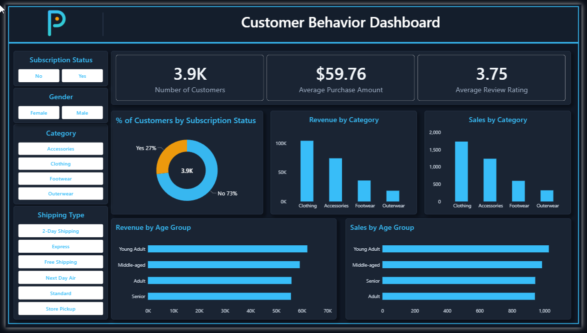

# Customer Shopping Behavior Analysis

An end-to-end analysis of 3,900 retail purchases, from data cleaning in Python to business questions answered in PostgreSQL and an interactive Power BI dashboard.



**[View the presentation (PDF)](presentation/customer_shopping_behavior_presentation.pdf)**

## Tools

- **Python (pandas)** for data cleaning and feature engineering
- **PostgreSQL** for the analysis queries
- **Power BI** for the dashboard

## Dataset

- **File:** `data/raw/customer_shopping_behavior.csv`
- **Size:** 3,900 rows, 18 columns
- **One row represents:** one customer and their most recent purchase
- **Source:** provided with the tutorial [COMPLETE Data Analytics Portfolio Project in 6 EASY Steps](https://www.youtube.com/watch?v=5PrZvPeUw60) by Amlan Mohanty. It is based on the [Customer Shopping Trends Dataset](https://www.kaggle.com/datasets/iamsouravbanerjee/customer-shopping-trends-dataset) by Sourav Banerjee on Kaggle.
- **Note:** this is a synthetic dataset created for learning purposes, not real company data. The tutorial copy contains 37 missing review ratings, which were filled during cleaning.

## Project Structure

```
customer-shopping-behavior-analysis/
├── data/
│   ├── raw/                  Original dataset, unedited
│   └── processed/            Cleaned dataset produced by the notebook
├── notebooks/
│   └── 01_data_cleaning.ipynb
├── sql/                      One file per business question
├── dashboard/
│   ├── customer_behavior_dashboard.pbix
│   └── screenshots/
└── presentation/
    └── customer_shopping_behavior_presentation.pdf
```

## Data Preparation

The full steps are in [`notebooks/01_data_cleaning.ipynb`](notebooks/01_data_cleaning.ipynb).

- Filled 37 missing review ratings with the median rating of the product's category
- Renamed all columns to lowercase snake_case for PostgreSQL
- Added `age_group`, splitting customers into four equal-sized groups by age:
  - Young Adult: 18 to 31
  - Adult: 32 to 44
  - Middle-aged: 45 to 57
  - Senior: 58 to 70
- Added `purchase_frequency_days`, converting purchase frequency text into an approximate number of days
- Dropped `promo_code_used`, which is identical to `discount_applied` in every row

## Business Questions

| # | Question | Query |
|---|---|---|
| 1 | Total revenue by gender | [`01_revenue_by_gender.sql`](sql/01_revenue_by_gender.sql) |
| 2 | Discounted customers who spent above average | [`02_discount_high_spenders.sql`](sql/02_discount_high_spenders.sql) |
| 3 | Top 5 products by average review rating | [`03_top_rated_products.sql`](sql/03_top_rated_products.sql) |
| 4 | Average purchase: Standard vs. Express shipping | [`04_shipping_comparison.sql`](sql/04_shipping_comparison.sql) |
| 5 | Spending of subscribers vs. non-subscribers | [`05_subscription_spend.sql`](sql/05_subscription_spend.sql) |
| 6 | Top 5 products by share of discounted purchases | [`06_discount_dependent_products.sql`](sql/06_discount_dependent_products.sql) |
| 7 | Customer segments: New, Returning, Loyal | [`07_customer_segments.sql`](sql/07_customer_segments.sql) |
| 8 | Top 3 products within each category | [`08_top_products_by_category.sql`](sql/08_top_products_by_category.sql) |
| 9 | Subscription rate among repeat buyers | [`09_repeat_buyers_subscription.sql`](sql/09_repeat_buyers_subscription.sql) |
| 10 | Revenue contribution by age group | [`10_revenue_by_age_group.sql`](sql/10_revenue_by_age_group.sql) |

## Findings

The 3,900 customers spent a total of **$233,081**, with an average purchase of **$59.76**.

### 1. Men bring in more revenue, but only because there are more of them

| Gender | Customers | Revenue | Share of revenue | Average purchase |
|---|---|---|---|---|
| Male | 2,652 | $157,890 | 68% | $59.54 |
| Female | 1,248 | $75,191 | 32% | $60.25 |

Men bring in twice as much revenue as women. This is because there are twice as many male customers, not because men spend more. Women actually spend slightly more per purchase.

### 2. Discounts do not lower spending much

839 customers used a discount and still spent more than the average purchase. That is half of all discounted purchases, almost exactly the same rate as purchases made at full price. Discounted purchases average $59.28, compared with $60.13 for full price purchases. In other words, discounts are not mainly being used by low spenders.

### 3. Product ratings are all very similar

| Rank | Product | Average rating |
|---|---|---|
| 1 | Gloves | 3.86 |
| 2 | Sandals | 3.84 |
| 3 | Boots | 3.82 |
| 4 | Hat | 3.80 |
| 5 | Skirt | 3.78 |

The best rated product (Gloves, 3.86) and the worst rated product (Shirt, 3.62) are only 0.24 points apart. No product stands out as much better or much worse than the rest. The overall average is 3.75 out of 5, which suggests customers are satisfied but not impressed.

### 4. Express shipping customers spend slightly more

| Shipping type | Average purchase |
|---|---|
| Express | $60.48 |
| Standard | $58.46 |

Express customers spend about $2 more per purchase. The gap is small, and across all six shipping types the average purchase only ranges from $58.46 to $60.73.

### 5. Subscribers do not spend more than non-subscribers

| Subscribed | Customers | Average spend | Total revenue |
|---|---|---|---|
| No | 2,847 | $59.87 | $170,436 |
| Yes | 1,053 | $59.49 | $62,645 |

Only 27% of customers are subscribed, and they spend about the same per purchase as everyone else. Right now the subscription is not leading to bigger purchases.

### 6. Some products sell on discount about half the time

| Product | Purchases with a discount |
|---|---|
| Hat | 50.00% |
| Sneakers | 49.66% |
| Coat | 49.07% |
| Sweater | 48.17% |
| Pants | 47.37% |

Across all products, 43% of purchases use a discount. These five are noticeably higher, which means they may rely on discounts to sell.

### 7. Most customers are loyal

| Segment | Previous purchases | Customers | Share |
|---|---|---|---|
| Loyal | More than 10 | 3,116 | 80% |
| Returning | 2 to 10 | 701 | 18% |
| New | 1 | 83 | 2% |

Four out of five customers have bought more than 10 times before. Only 2% are new, so the business keeps its customers well but is not bringing in many new ones.

### 8. No single product dominates any category

| Category | 1st | 2nd | 3rd |
|---|---|---|---|
| Accessories | Jewelry (171) | Belt (161) | Sunglasses (161) |
| Clothing | Blouse (171) | Pants (171) | Shirt (169) |
| Footwear | Sandals (160) | Shoes (150) | Sneakers (145) |
| Outerwear | Jacket (163) | Coat (161) | |

Numbers in brackets are purchase counts. The top products in each category are only a few purchases apart, and Blouse and Pants are tied. Demand is spread evenly across products. Outerwear has only two products, so it has no third place.

### 9. Buying more often does not make customers more likely to subscribe

Among repeat buyers (more than 5 previous purchases), 958 out of 3,476 are subscribed, which is 27.6%. Among customers with 5 or fewer purchases, the rate is 22.4%. Frequent buyers are only slightly more likely to subscribe, and most of them still have not.

### 10. Revenue is spread evenly across age groups

| Age group | Ages | Revenue | Share |
|---|---|---|---|
| Young Adult | 18 to 31 | $62,143 | 27% |
| Middle-aged | 45 to 57 | $59,197 | 25% |
| Adult | 32 to 44 | $55,978 | 24% |
| Senior | 58 to 70 | $55,763 | 24% |

Young adults bring in the most revenue, but the difference between the highest and lowest group is only about 3 percentage points. No age group is being left behind.

### A note on the data

Some patterns in this dataset look unusual and are worth keeping in mind:
- Every discounted purchase was made by a male customer. No female customer received a discount.
- Every subscriber used a discount.

These patterns are probably a result of how the dataset was created, so findings about discounts mainly describe male customers.

## Recommendations

1. **Give the subscription a clearer benefit.** Subscribers spend the same as everyone else, so the current offer is not changing behaviour. Test perks such as free express shipping or early access to new products, and track whether subscriber spending goes up.
2. **Invite loyal customers to subscribe.** 80% of customers are loyal, but most frequent buyers are not subscribed. Target them directly with subscription offers, since they already buy often.
3. **Put more effort into finding new customers.** Only 2% of customers are new. Referral rewards or a first purchase offer could help grow the customer base.
4. **Review discounts on Hat, Sneakers, Coat, Sweater and Pants.** About half their sales use a discount. Try reducing discounts on these products and check whether sales drop. If they don't, the business keeps more profit on each sale.
5. **Market more to female customers.** Women spend slightly more per purchase but make up only a third of customers. Bringing in more female customers is a clear way to grow revenue.
6. **Promote express shipping at checkout.** Express customers spend a little more. Offering free express shipping above a set order value could encourage bigger orders.
7. **Find out why ratings are only average.** Ratings sit around 3.75 for every product. Customer feedback on the lowest rated products (Shirt, Jeans and Blouse) is a good place to start.

## How to Run

1. Clone the repository and install the dependencies:
   ```
   pip install -r requirements.txt
   ```
2. Create a PostgreSQL database named `customer_behavior`.
3. Copy `.env.example` to `.env` and add your database credentials.
4. Run `notebooks/01_data_cleaning.ipynb` from the `notebooks` folder. It cleans the data and loads it into a table named `customer`.
5. Run any query in the `sql/` folder against the database.
6. Open `dashboard/customer_behavior_dashboard.pbix` in Power BI Desktop.

## Acknowledgements

This project follows the structure of the tutorial by [Amlan Mohanty](https://www.youtube.com/watch?v=5PrZvPeUw60). The data checks, query fixes, findings and recommendations in this repository are my own.

## Author

**Aaron George Saju**
[GitHub](https://github.com/aarongeorge96)
